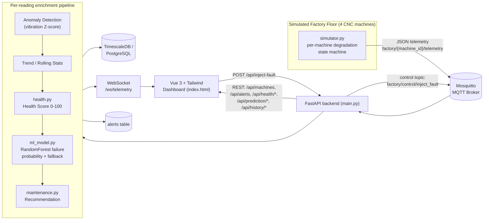

# Predictive Maintenance Telemetry Dashboard
**Problem Statement 9 - Predictive Maintenance for Manufacturing Machines**

> **This is a prototype/demo using synthetic telemetry data.** The ML model
> is trained on synthetically generated data (`generate_dataset.py`) and its
> accuracy numbers reflect fit to that synthetic data only - they are **not**
> a claim of real-world industrial predictive accuracy.

## 1. Problem Statement

Unplanned downtime on manufacturing equipment (CNC machines, motors, etc.)
is expensive. Problem Statement 9 asks for a system that goes beyond
"the machine broke, alert someone" and instead continuously watches
machine telemetry, scores machine health, predicts failure risk *before*
it happens, explains *why* the risk is elevated, and recommends a concrete
maintenance action.

## 2. What This Project Demonstrates

```
Telemetry -> Anomaly Detection -> Health Score -> Trend Analysis
          -> Failure Probability (ML) -> Maintenance Recommendation
          -> Dashboard Visualization -> Explainable Prediction
```

## 3. System Architecture

The original pipeline is unchanged - this upgrade extends every stage
rather than replacing the architecture.



## 4. Technologies

| Layer            | Technology                                   |
|-------------------|-----------------------------------------------|
| Ingestion         | MQTT (Eclipse Mosquitto), Paho MQTT client    |
| Backend           | FastAPI, Python, WebSockets                   |
| Database          | TimescaleDB (PostgreSQL), psycopg2 (pooled)   |
| ML                | scikit-learn RandomForestClassifier, pandas, numpy, joblib |
| Frontend          | Vue 3 (CDN), Tailwind CSS (CDN), Chart.js (CDN) |
| Visualization     | Grafana (embedded panel)                      |
| Orchestration     | Docker Compose (Mosquitto + TimescaleDB + Grafana) |

## 5. MQTT Pipeline

- `simulator.py` runs 4 independent machine state machines and publishes
  one JSON telemetry message per machine per second to
  `factory/{machine_id}/telemetry`.
- `main.py` subscribes to the wildcard topic `factory/+/telemetry` so any
  number of machines are picked up automatically.
- A second, lightweight control channel, `factory/control/inject_fault`,
  lets the backend tell the simulator "push this machine into a fault" for
  the live demo button, without the backend faking sensor data itself.

## 6. Database

`machine_telemetry` (original columns preserved) is extended with:
`health_score`, `health_status`, `failure_probability`, `failure_risk`,
`maintenance_priority`, `machine_status` via `ALTER TABLE ... ADD COLUMN
IF NOT EXISTS`, so existing data is never destroyed. A new `alerts` table
stores the alert history. A small connection pool (`psycopg2.pool`) is
used instead of opening a new connection per insert.

## 7. Anomaly Detection

Unchanged statistical approach: a rolling 30-reading vibration buffer per
machine, anomaly triggers when `|Z-score| > 2.5`.

## 8. ML Failure Prediction

- `generate_dataset.py` builds `data/training_data.csv`: six synthetic
  scenario families (healthy, overheating, excessive vibration, abnormal
  RPM, combined degradation, borderline-healthy) with engineered features
  (trend, rolling average/std, recent anomaly count) - the assumptions are
  documented in the script's comments.
- `train_model.py` trains a `RandomForestClassifier`, prints accuracy /
  precision / recall / confusion matrix, and saves
  `models/failure_model.pkl`.
- `ml_model.py` loads that model and exposes `predict_failure(telemetry,
  history)`. If the model file isn't present or fails to load, it falls
  back to a transparent rule-based probability estimate instead of
  crashing the backend.

## 9. Health Score

`health.py` computes a deterministic 0-100 score: deductions for how far
temperature/RPM/vibration sit outside their normal ranges, extra
deductions for a worsening trend, and extra deductions per recent
anomaly. Never randomized. Thresholds: `>=80 HEALTHY`, `50-79 WARNING`,
`<50 CRITICAL`.

## 10. Maintenance Recommendation

`maintenance.py` picks a priority (worst of health status / failure risk)
and an action + possible cause based on which sensor(s) are actually out
of range (vibration -> bearings/shaft alignment, temperature -> cooling
system, RPM -> motor/drive system, multiple at once -> combined
preventive maintenance).

## 11. Dashboard

Keeps the original dark industrial theme, WebSocket indicator, Inject
Fault button, temperature/RPM/vibration cards, Grafana panel and live
telemetry table. Adds: fleet summary row, machine selector, health-score
ring, failure-probability bar, maintenance card, "why is this machine at
risk" panel, live Chart.js trend charts, and an alert history panel.

## 12. Install

```bash
cd pm_dashboard
python -m venv venv && source venv/bin/activate   # optional but recommended
pip install -r requirements.txt
```

## 13. Run

```bash
# 1. Start infrastructure (MQTT broker, TimescaleDB, Grafana)
docker compose up -d

# 2. Generate the synthetic training dataset
python generate_dataset.py

# 3. Train the failure-prediction model
python train_model.py

# 4. Start the FastAPI backend
uvicorn main:app --reload --port 8000

# 5. Start the simulator (separate terminal)
python simulator.py

# 6. Open the dashboard
# simply open index.html in a browser (it talks to http://localhost:8000
# and ws://127.0.0.1:8000/ws/telemetry)
```

If you skip steps 2-3, `main.py` still works - `ml_model.py` automatically
falls back to a rule-based failure probability until a trained model is
present.

## 14. Demonstrating Fault Injection

1. Open the dashboard, pick a machine from the selector (or let it stay on
   whichever machine you last picked).
2. Click **Inject Fault (Demo)**. This publishes a control message that
   tells the simulator to push that machine into an accelerated
   degradation sequence.
3. Watch, in real time, over the next ~10-20 seconds:
   - Vibration/temperature/RPM drift out of normal range
   - The anomaly banner fires
   - Health Score drops, status moves HEALTHY -> WARNING -> CRITICAL
   - Failure Probability rises, risk moves LOW -> ... -> CRITICAL
   - The maintenance card updates with a concrete action + cause
   - The "why is this machine at risk" panel lists the actual reasons
   - A new entry appears in Recent Alerts
   - The fleet summary row's At Risk / Critical counts update
4. The simulator has a small chance of "repairing" the machine back to
   NORMAL after holding at a critical level, so re-running the demo later
   in the same session still works.

## 15. Folder Structure

```
pm_dashboard/
├── main.py                 # FastAPI backend (MQTT, DB, WS, REST, enrichment pipeline)
├── simulator.py             # Multi-machine telemetry simulator w/ degradation states
├── config.py                 # All configuration / env vars / normal ranges
├── health.py                 # Health score + explainability reasons
├── maintenance.py            # Maintenance recommendation engine
├── ml_model.py                # Loads trained model, predict_failure(), rule fallback
├── generate_dataset.py         # Synthetic training data generator
├── train_model.py               # Trains + evaluates + saves the RandomForest model
├── index.html                    # Vue 3 + Tailwind + Chart.js dashboard
├── docker-compose.yml             # Mosquitto + TimescaleDB + Grafana
├── requirements.txt                # Python dependencies
├── data/
│   └── training_data.csv            # generated by generate_dataset.py
└── models/
    └── failure_model.pkl              # generated by train_model.py
```

## 16. Test Checklist

- [ ] `docker compose up -d` starts Mosquitto, TimescaleDB and Grafana without errors
- [ ] `python simulator.py` connects to MQTT and prints per-machine telemetry every second
- [ ] `uvicorn main:app --reload --port 8000` connects to MQTT and subscribes to `factory/+/telemetry`
- [ ] `GET http://localhost:8000/` returns backend status + tracked machine list
- [ ] MQTT -> FastAPI: backend console prints anomaly logs when vibration spikes
- [ ] FastAPI -> database: rows appear in `machine_telemetry` (check via `psql` or a DB client) including the new health/prediction columns
- [ ] FastAPI -> WebSocket: opening `index.html` shows `LIVE CONNECTED` and live-updating cards
- [ ] Anomaly detection: vibration Z-score > 2.5 triggers the red anomaly banner
- [ ] Health score: `GET /api/health/CNC_MACHINE_01` returns a 0-100 score + status
- [ ] ML prediction: `GET /api/prediction/CNC_MACHINE_01` returns `failure_probability` + `failure_risk` + `prediction_reasons`
- [ ] Failure probability: value changes as telemetry drifts (compare before/after fault injection)
- [ ] Maintenance recommendation: `maintenance_action` / `possible_cause` change based on which sensor is out of range
- [ ] Multiple machines: `GET /api/machines` returns all 4 machines independently
- [ ] Dashboard updates: summary row, selected-machine cards and charts update live via WebSocket
- [ ] Fault injection: clicking "Inject Fault (Demo)" visibly escalates the selected machine over the following seconds
- [ ] Alert history: `GET /api/alerts` and the dashboard's Recent Alerts panel show new entries as they occur
